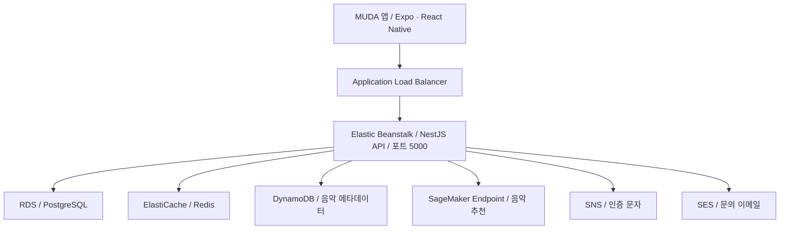

# MUDA | 뮤다 서버

> 일기에 배경음악을 입히다

뮤다는 하루의 감정과 이야기를 기록하고, 어울리는 음악을 추천받아 일기 카드로 간직하는 앱입니다. 이 저장소는 인증, 일기와 음악 데이터 관리, 통계 및 외부 추천 서비스 연동을 담당합니다.

Team GLOW가 제작했으며, iOS 앱은 출시 후 현재 스토어에서 내려간 상태입니다. 과거 데이터베이스도 폐기되어 이 저장소의 설정만으로 당시 서비스를 이용할 수는 없습니다.

[공식 인스타그램](https://www.instagram.com/muda_diary.official) · [텀블벅 프로젝트](https://tumblbug.com/musicdiary)

## 프로젝트 성과

2024.09.06 - 2024.10.03 진행한 [텀블벅 프로젝트](https://tumblbug.com/musicdiary)에서 후원자 62명, 모금액 1,332,004원, 목표 달성률 266%를 기록했습니다.

## 주요 기능

- 감정, 주제, 템플릿을 활용한 일기 작성 및 임시저장
- 외부 AI 서비스와 연동한 음악 추천
- 일기와 음악의 일별·월별 아카이브
- 월별·연도별 감정 및 음악 취향 통계
- Google·Apple 로그인과 휴대전화 인증
- 사용자 정보 관리, 문의 접수 및 회원 탈퇴

## 기술 스택

| 영역 | 기술 |
| --- | --- |
| 언어·서버 | TypeScript, NestJS 10 |
| 관계형 데이터 | PostgreSQL, Prisma 5 |
| 캐시·인증 관련 데이터 | Redis |
| 음악 메타데이터 | DynamoDB, Dynamoose |
| 인증 | JWT, Google·Apple OAuth |
| API 문서 | Swagger |
| 외부 서비스 | SageMaker, SNS, SES |
| 배포 설정 | Elastic Beanstalk, Application Load Balancer, Docker |

## 인프라 구조

아래는 저장소의 배포 설정과 서비스 연결 코드에서 재구성한 구조입니다. 실제 AWS 리소스를 조회한 결과가 아니며, 현재 가동 상태나 당시 운영 환경의 전체 구성을 보증하지 않습니다.



| 구성 | 역할 및 코드 근거 |
| --- | --- |
| Elastic Beanstalk·ALB | 배포 설정에 애플리케이션 환경, ALB, `/api/v1` 상태 확인 경로 정의 |
| RDS PostgreSQL | 과거 배포 설정의 RDS 연결 정보 및 Prisma PostgreSQL 스키마 |
| ElastiCache Redis | 캐시 클러스터·보안 그룹·서브넷 그룹 정의와 Redis 저장소 |
| DynamoDB | `musicdiary_db` 테이블에서 추천 음악 메타데이터 조회 |
| SageMaker | AWS 서명을 적용해 외부 음악 추천 엔드포인트 호출 |
| SNS·SES | 휴대전화 인증 문자 및 문의 이메일 발송 |

Node.js 플랫폼과 Docker 배포 관련 파일이 함께 남아 있습니다. 최종 운영에 사용한 방식은 확인되지 않았으므로 두 방식의 설정 자료로 보관합니다. GitHub Actions의 배포 단계는 현재 주석 처리되어 있습니다.

과거 연결 정보는 환경변수 또는 예시값으로 대체했습니다. 네트워크 설정은 `.example` 파일로 보관하며, 자동으로 리소스를 생성하지 않습니다. 파일별 용도와 패키징 방법은 [인프라 설정 안내](docs/infrastructure/README.md)를 참고하세요.

## 일기와 음악 추천 흐름

1. 작성 중인 일기를 `EDIT` 상태로 생성합니다.
2. 감정, 주제, 본문 등 작성 내용을 저장합니다.
3. 음악 추천 요청 시 일기를 `PENDING` 상태로 전환하고 외부 AI 서비스를 호출합니다.
4. 추천 음악 후보를 저장한 뒤 `EDIT` 상태로 돌아옵니다.
5. 사용자가 카드를 완성하면 `DONE` 상태로 저장합니다.

추천 모델 자체는 이 저장소에 포함되지 않습니다. 서버는 일기와 사용자 선호 정보를 요청 형식으로 변환하고, 추천 결과를 음악 메타데이터와 연결합니다.

## 코드 구조

```text
src/
  auth/        회원가입, 로그인, 휴대전화 인증
  users/       사용자 정보, 통계, 문의, 탈퇴
  diaries/     일기, 감정, 주제, 템플릿
  musics/      추천 음악 후보 및 음악 아카이브
  genres/      음악 장르
  database/    Prisma, Redis 설정 및 저장소
  services/    AI, 문자, 이메일 서비스 연동
  common/      인증 가드, 검증, 예외 처리, 로깅
```

## 개발 시작하기

Node.js 20 기준 배포 설정이 포함되어 있습니다. PostgreSQL, Redis, DynamoDB 음악 데이터 및 외부 서비스 연결 설정을 별도로 준비해야 합니다.

필수 환경변수는 [검증 스키마](src/common/config/validation-schema.ts)에서 확인할 수 있습니다. Apple 로그인에는 `APPLE_CLIENT_ID`, 인증 문자에는 `SNS_AWS_REGION`도 사용합니다. 실제 값은 실행 환경 또는 배포 플랫폼에 설정합니다.

```bash
npm ci
npm run db:generate
npm run start:dev
```

위 명령은 데이터베이스 스키마나 기준 데이터를 생성하지 않습니다. 새 개발 DB에는 마이그레이션과 시드 적용이 별도로 필요합니다. 기본 시드는 `create` 기반이므로 기존 데이터가 있는 DB에 반복 실행하지 않습니다.

- 기본 포트: `5000`
- API 기본 경로: `/api/v1`
- 상태 확인: `GET /api/v1`
- Swagger: `http://localhost:5000/api/v1/api-docs`
- 클라이언트 API 주소에는 `/api/v1`까지 포함합니다.

```bash
npm run build
npm run start:prod
```
